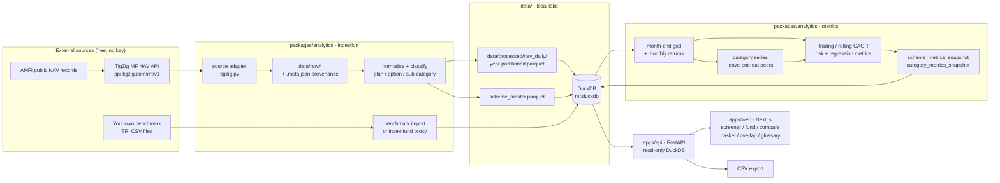

# Indian Mutual Fund Screener

A local-first research tool for Indian mutual funds.
It computes trailing and rolling annualised returns, peer-relative performance, and risk-adjusted metrics from AMFI NAV history, stores them in a local DuckDB + Parquet lake, and serves them through a typed API and a screener UI.
A keyboard-navigable search in the header finds any of the 38,000+ schemes by name or AMC, backed by a DuckDB full-text index rather than a table scan.

It exists to fill the gaps in the free screeners: rolling-return distributions rather than a single trailing number, leave-one-out sub-category comparison rather than a category average that includes the fund itself, and an explicit reason attached to every value that could not be computed.

## Not investment advice

This is an analytics and research tool.
Nothing it produces is advice, a recommendation, or a solicitation.
Historical returns do not guarantee future returns, and every metric here is a description of the past.
The preset screens are editable starting points, not shortlists.
The composite score on `/picks` is a declared-weight percentile decomposition against peer-group peers, not a rating or a recommendation.

## Architecture



The frontend never reads the data files: it only calls the API, and the API only reads whitelisted columns through parameterised SQL.

## Prerequisites

- Ubuntu or any Linux with a POSIX shell, plus `make` and `curl`
- [uv](https://docs.astral.sh/uv/) for Python (it installs Python 3.12 itself)
- Node.js 20+ and [pnpm](https://pnpm.io/)

```bash
sudo apt update && sudo apt install -y make curl git
curl -LsSf https://astral.sh/uv/install.sh | sh
curl -fsSL https://deb.nodesource.com/setup_22.x | sudo -E bash - && sudo apt install -y nodejs
sudo npm install -g pnpm
```

## Quick start with the sample dataset

```bash
cd mf-screener
make bootstrap      # installs dependencies, creates data dirs, copies .env.example to .env
make data-sample    # ~70 representative schemes with full NAV history, a few MB
make test           # Python + TypeScript test suites
make dev            # API on :8000, web UI on :3000
```

Open <http://localhost:3000>.
API docs are at <http://localhost:8000/docs> (OpenAPI JSON at `/openapi.json`).

`make data-sample` picks the longest-history Direct Growth funds across Mid Cap, Small Cap, Flexi Cap, Large Cap, Value, Multi Cap and Index Funds, plus a few Regular / IDCW / matured schemes so the universe filters have something to exclude, and it builds two clearly-labelled benchmark proxies from index funds.

To run the frontend on another port:
`PORT=3001 make web` (add that origin to `MF_CORS_ORIGINS` in `.env`).

## The full dataset

```bash
make data-build     # scheme master + full NAV history + benchmarks + metrics + validation
```

This downloads the complete AMFI NAV history (~170 MB parquet, 37M+ rows) and computes metrics for every scheme with enough history.

**Resumable.** The transfer streams to a `.part` file next to the destination and records the artefact's ETag beside it.
If it is interrupted, the next `make data-nav` continues from the byte it stopped at rather than starting over.
A partial file is only ever continued when the server is still serving the same ETag; otherwise it is discarded, so a resumed download can never splice two revisions of the dataset together.

**Idempotent.** A HEAD request skips the download entirely when the remote file is unchanged, and the normalisation step is skipped when the lake was already built from that exact checksum.
`FORCE=1 make data-nav` overrides both.

**Bounded memory.** The 37M rows are never loaded into pandas.
DuckDB scans the source parquet, normalises and deduplicates it, and writes the year-partitioned lake in a single streaming `COPY`, spilling to `data/cache/duckdb-spill` past `MF_DUCKDB_MEMORY_LIMIT` (default 3 GB).
Peak resident memory stays near that ceiling regardless of dataset size.

**Validated before it is trusted.** The downloaded parquet's footer is read first and checked against the canonical column mapping.
A missing required column aborts the load with the actual source columns printed, rather than producing a lake full of nulls.
New upstream columns are logged as schema drift and ignored.

Individual steps:

```bash
make inspect                 # provider's live columns, the canonical mapping, and the local file's real schema
make data-master             # scheme master only (~1.5 MB)
make data-nav                # full NAV history only
make provenance              # the raw artefacts the store was built from, with checksums
make metrics                 # recompute metrics from what is already stored (every core but one)
make metrics JOBS=1          # ... on a single process, for a machine short of memory
make data-aum-history        # AMFI's scheme-wise quarterly AAUM history, one request per quarter
make validate                # row counts, coverage and data-quality checks
```

## Refreshing

```bash
make data-refresh            # incremental top-up of recent NAVs, then rebuild metrics
```

It fetches only the last 45 days for active schemes through the API's date-bounded endpoint and falls back to a full download when no local dataset exists.
Only the year partitions the new rows actually touch are rewritten, so a daily top-up costs a fraction of a full rebuild; where a refreshed row collides with one already stored, the freshly fetched value wins.
Every run is recorded in the `ingest_log` table and surfaced on the dashboard, and every raw file the store was built from is recorded with its checksum in `raw_file`.

**After pulling work that adds a metric, run `make metrics` before starting the app.**
Snapshot columns are added to `scheme_metrics_snapshot` by the pipeline, not by a schema migration, so a store built before a new metric landed does not have its column.
`/columns` still declares it, and `/screen` then fails with a DuckDB `BinderException` naming the missing column rather than degrading, because the whitelist and the table have to agree for the parameterised SQL to be safe.
A rebuild over the full lake took roughly 40 minutes on a single process: two runs over 36,917 schemes on 2026-09-12 took 40m29s and 52m42s, the second while a test suite was running.
The per-scheme metrics now run across processes - `make metrics` uses every core but one, `JOBS=n` sets it, and `JOBS=1` is the old serial path - and the same 36,917-scheme build then takes about 15 minutes on 15 workers (measured 2026-09-12, 17:51 to 18:06, on a 16-core box).
Cores are not the limit, memory is: each worker's RSS reads around 1.2 GB but most of that is pages shared with the parent, and on a machine with less headroom than this one `JOBS=4` is the sensible setting rather than 0.
Workers are forked after the shared NAV series is built, so they inherit it copy-on-write and are handed nothing but a scheme code; every write stays on the parent's single DuckDB lock, and `tests/test_pipeline_parallel.py` asserts a parallel build agrees with a serial one row for row.
Progress is still not linear - the daily-NAV drawdown pass runs first, is not parallelised, and the per-scheme rate roughly triples once it is done, so an estimate taken in the first few minutes will be far too pessimistic. `make data-refresh` includes it.

**One writer at a time.** DuckDB allows a single process to hold the database file for writing. The API serves read-only, so it does not block anything, but a running API still needs to let go before a CLI write. Either stop it, or trigger the step through the API itself:

```bash
curl -X POST localhost:8000/admin/refresh \
  -H "content-type: application/json" -d '{"step": "data-refresh"}'
```

If you forget, the CLI says so and tells you both options rather than failing with a stack trace.

## Benchmarks

This project ships no index data.
Free NAV data is public record; index total-return series are not.

### The CSV contract

Required columns: `date`, `benchmark_id`, `benchmark_name`, `currency`, and one of `total_return_index` or `price`.
Optional: `asset_class`, `source`.

`currency` is required and has no default.
A downloaded S&P 500 file has no currency column, and assuming INR would store a USD series as rupees; every benchmark-relative metric computed from it would then be measuring the exchange rate, with nothing left to detect it by.
Refusing the file is the only safe answer.

Check a file before loading it:

```bash
make benchmark-validate FILE=data/benchmarks_sample/nifty50_tri_sample.csv
make benchmark-import   FILE=data/benchmarks_sample/nifty50_tri_sample.csv
```

Nothing is written unless the whole file passes, and every problem is reported at once with its CSV line number.
A file is rejected for a missing required column, a date that does not parse, an index level that is zero, negative or non-numeric, two rows sharing a `benchmark_id` and `date`, one `benchmark_id` carrying two currencies, a currency that is not a three-letter ISO code, or a series with a single row.
A total-return index is preferred over a price index: a growth-option NAV reinvests dividends, so a price index understates the benchmark and flatters every fund measured against it.

Import warns without failing when a series is too short for any risk metric, when it is in a foreign currency, and when both value columns are present.

### Currency, and why the S&P 500 shows no alpha

Fund NAVs are published in rupees.
A benchmark in any other currency is stored and displayed, but no benchmark-relative metric is computed against it: alpha, beta, tracking error, the benchmark information ratio, the benchmark excess return and the rolling beat-benchmark share all stay null with reason `benchmark_currency_mismatch`, and the scheme carries the same flag.
This project performs no FX conversion.
The rule is enforced in four places, because the resulting numbers would look entirely plausible: the import refuses an unlabelled file, the mapping always prefers an INR series wherever it sits in the fallback order, the pipeline withholds the metrics, and the fund page states in words which index is mapped and why its columns are blank.

To compare an INR feeder fund against a foreign index, convert the index to INR at each month end yourself and import that series with `currency,INR`.

### Proxies

Or build a labelled proxy from an index fund's NAV, which is what `make data-sample` does:

```bash
make benchmark-proxy CODE=100484 ID=NIFTY50_TRI NAME="Nifty 50 (index-fund proxy)"
```

A proxy is net of that fund's expense ratio and tracking error, so it is a floor for the index rather than the index.
Every metric derived from one is marked `index_fund_proxy` in the API and shown with a `proxy` badge in the UI.
No plan of the fund a proxy was built from is mapped to it, since that would measure the fund against itself.
A proxy is always in rupees, with no option to say otherwise: it comes from an AMFI NAV, and even a fund tracking a US index files that NAV in rupees, having already absorbed the exchange rate its investors bore.

### Mapping and coverage

The sub-category to benchmark mapping lives in `packages/analytics/benchmark_map.yaml`.
A scheme falls back to the broad-market series when its specific index is not loaded, and stays unmapped when nothing fits - in which case alpha, beta, tracking error and benchmark information ratio are null with reason `benchmark_not_mapped`, never silently computed against the wrong index.

```bash
make benchmark-map        # apply the config
make benchmark-coverage   # what is loaded, what it covers, and what it does not
```

`make validate` reports the same coverage warnings, and the `/benchmarks` page shows the loaded series, the mapping rules, the unmapped sub-categories and every warning in one place.
Coverage warnings cover foreign-currency series, series too short for a 3-year risk metric, index-fund proxies, and the share of schemes with no benchmark at all.

The stored metrics are a snapshot while the mapping is live, so re-mapping without re-running `make metrics` leaves the two disagreeing.
The fund page detects that case and says the benchmark figures are out of date rather than attributing them to the newly mapped index.

## Holdings and portfolio overlap

This project ships no holdings data, and fetches none.

There is no consolidated holdings feed in India: AMFI publishes none, SEBI requires each of roughly forty-four AMCs to publish its own monthly portfolio on its own site in its own layout, and scraping those, automating a browser against them, or buying past them with a paid API are all refused by `docs/data-policy.md`.
The one free candidate API, `mfdata.in`, has never once answered: HTTP 522 on 2026-09-09, and HTTP 522 again on `/`, `/docs` and `/openapi.json` when re-probed on 2026-09-12.

So holdings work the way benchmarks do here - the engine and a strict import contract ship, and you supply the file from a source you legitimately have.
A dormant adapter for the candidate API exists in `enrich/holdings.py` for the day it becomes reliable; nothing calls it, and a test asserts nothing does.

### The CSV contract

Required columns: `scheme_code`, `as_of`, `instrument_name`, `weight`.
Optional: `instrument_id`, `quantity`, `market_value`, `sector`, `asset_type`.

`weight` is a **fraction of net assets, never a percentage**: 4.5% of the portfolio is `0.045`.
A file of percentages loaded as fractions would report a fund as 4,500% invested, and every overlap figure computed from it would be a hundred times too large while still looking like a plausible number.
`as_of` is the disclosure month and is collapsed to that month's end, so two files dating the same month differently land on one snapshot.
`asset_type`, where given, is one of `equity`, `debt`, `cash`, `derivative`.

```bash
make holdings-validate FILE=path/to/holdings.csv
make holdings-import   FILE=path/to/holdings.csv
```

Nothing is written unless the whole file passes, and every problem is reported at once with its CSV line numbers.

A file is **rejected** for: a missing required column; an `as_of` that does not parse; a weight that is non-numeric, negative, or above 1; a scheme-month that is plainly a percent file (every weight between 1 and 100, summing to about 100) - which is refused with the instruction to divide by 100, and never silently converted; two rows sharing a scheme, month and instrument; a blank `instrument_name`; an `asset_type` outside the four allowed values; a `scheme_code` that is not in `scheme_master`; and a scheme-month whose weights sum above 1.02, which allows for rounding and nothing more.

It **warns without failing** when a scheme-month's weights sum below 0.90, because published portfolios often omit cash, and when a holding carries no `instrument_id` - that holding is then matched by name, so it will only overlap against another fund naming the same instrument identically.

Re-importing a scheme-month replaces it wholesale rather than merging: a portfolio is a complete list, so a position dropped from the file is dropped from the store instead of lingering at last month's weight.

### What holdings unlock

- `GET /schemes/{code}/holdings` - the latest month's holdings sorted by weight, with top-10 concentration, sector allocation, asset-type split, and the as-of month stated prominently.
- `GET /schemes/{code}/holdings/turnover` - between consecutive disclosure months, half the sum of absolute weight changes, the same convention `style_drift_3y` uses.
- `GET /overlap?codes=A,B[,C,D,E]` - per pair, the overlap percentage as the sum of the minimum weight per shared instrument, with both weights for every shared instrument. Two funds whose latest portfolios are more than a month apart are refused, because comparing a January portfolio with a June one measures five months of trading.

Every one of these returns a named reason rather than an error when the store carries nothing.

The holdings endpoint also returns the fund's **returns-based style exposure alongside** the filed portfolio, and flags when the two disagree - a portfolio at or above 65% equity that the style basis cannot explain, or one below it that the basis explains well.
Both readings are always shown.
The disagreement is information: a fund that has traded since the filing, or one the all-equity Indian basis does not cover.

Holdings are enrichment under the T3.1 fence: they never enter `scheme_metrics_snapshot`, a ranking or a risk computation, and - unlike `scheme_attributes` - they are deliberately not screener columns either.
A weight is a portfolio fact about one month; a screener column is something a fund gets ranked by.

## Fund tearsheet

Every fund page carries a print-only, one-page tearsheet, built for printing or saving to PDF rather than for the browser.
It condenses identity, trailing returns, rolling return distribution, risk and risk-adjusted metrics, the worst drawdowns, cost against peers, estimated style exposure, and every missing-data reason onto a single sheet, with the methodology version and the as-of date in the footer.
The disclaimer is printed on the sheet itself, not linked.
Printing the interactive page (browser Print or Print to PDF) hides the site navigation and the on-screen panels and renders only the tearsheet; the two views share the same fetched data, so the tearsheet never diverges from what the page shows.
A scheme with no computable metrics still prints its one-card "no metrics for this scheme" page, which already states the reason and already fits one page.

## Running the pieces separately

```bash
make api            # uvicorn on :8000
make web            # next dev on :3000 (or PORT=3001 make web)
make dev            # both
make build          # production build of the frontend
```

## Tests and checks

```bash
make test           # pytest + vitest
make test-py        # pytest only
make test-js        # vitest only
make lint           # ruff check, ruff format --check, mypy, eslint, prettier
make typecheck      # tsc across the workspace
make e2e            # production build, then Playwright drives it in a browser
```

The Python tests cover the metric definitions against hand-computed values (CAGR, rolling windows, Sharpe, Sortino, volatility, tracking error, information ratio, alpha/beta on synthetic linear data, the alpha t-statistic against a closed-form OLS formula and its false-positive rate on pure noise, maximum drawdown, leave-one-out peer averages, ratio behaviour on a non-positive denominator, single-scheme categories, monthly resampling with gaps, SIP XIRR against a constant-growth series and an independently-solved irregular one, capture ratios, drawdown recovery days and calendar-year summaries, quartile ranking and persistence on synthetic categories, and universe filtering), plus an end-to-end suite that builds a synthetic lake, runs the real pipeline over it, and exercises the API's filtering, sorting, pagination, column selection and CSV export.
No test touches the network.

`make e2e` runs `apps/web/e2e` against whatever store is loaded, sample or full, picking its funds from the live data.
It starts the API and the production build itself, or reuses them if they are already running.
It covers header search, a preset with its CSV export, column sorting, compare, basket weights, the overlap page without holdings, and every page at desktop and phone width with no console errors, broken values or sideways scroll.
Screenshots and the exported CSV land in `apps/web/test-results/artifacts/`.
Playwright's own browser is used unless `CHROMIUM` points at one, for example `CHROMIUM=/usr/bin/chromium make e2e`.

## Methodology summary

The `/methodology` page renders all of this with formulas; this is the short version.

- **Observations.** Risk and rolling metrics use month-end NAV and monthly returns. Daily NAV is used for charts. The last NAV published in a calendar month is that month's observation, but only within 10 days of the month end - which drops the running month, so a part-month is never compared against a full one. Missing months stay missing; NAV is never forward-filled.
- **Annualisation.** sqrt(12) for monthly statistics, sqrt(252) if daily statistics are ever used. Standard deviations use the sample estimator (ddof = 1).
- **Risk-free rate.** 6.5% a year by default, converted geometrically: `(1 + annual) ** (1/12) - 1`. Set `MF_RISK_FREE_ANNUAL` in `.env`.
- **Trailing CAGR.** `(NAV_end / NAV_start) ** (1/h) - 1` for h = 1, 3, 5, 10, anchored on the latest month-end, with the start observation accepted only within the tolerance. Start date and observation count are stored.
- **Rolling CAGR.** Every overlapping 1Y, 3Y, 5Y and 10Y window, summarised by mean, median, min, max, dispersion, share positive, share beating the sub-category and share beating the benchmark. A summary needs at least 12 valid windows (`MF_MIN_ROLLING_WINDOWS`). Overlapping windows share months and are not independent observations; the UI says so. The peer-relative, benchmark-relative and risk metrics stop at 3 years: a 1-year window holds about 10 matched monthly observations, too thin a sample for a beta or a Sharpe a screener will sort on.
- **SIP XIRR.** Trailing CAGR is a lump sum in and a lump sum out; most investors instead put money in every month. `sip_xirr_1y/3y/5y/10y` model that: one unit bought at each month-end NAV in the window, the whole holding redeemed at the last observation, solved for the annualised rate with a bracketed root finder (Brent's method or an equivalent bisection) rather than a Newton guess, so a series with no root between -99.99% and +2000% reports the reason `sip_xirr_not_bracketed` instead of a plausible wrong rate. Annualised on actual/365 days, the convention a spreadsheet's XIRR uses, not the nominal-year exponent trailing CAGR uses. Below 12 monthly contributions it is null with reason `insufficient_observations`. `rolling_sip_xirr_3y_median` and `rolling_sip_xirr_5y_median` are the median across every overlapping window, gated by the same `MF_MIN_ROLLING_WINDOWS` floor.
- **After-tax and after-exit-load returns.** `GET /schemes/{code}/net-returns?horizon=&mode=lumpsum|sip` is a display layer over the trailing CAGR or SIP XIRR above, never a stored ranking column, because the applicable rate depends on the holder, not the fund. Orientation for capital gains tax - equity-oriented or debt-oriented - is read off `clean_category` and `clean_sub_category`, never guessed: a Hybrid sub-category whose SEBI mandate lets the equity share float across the 65% line (Balanced Advantage, Dynamic Asset Allocation, Multi Asset Allocation) comes back null with reason `tax_treatment_undetermined`. Equity-oriented gains are taxed at the long-term rate above an exemption past `MF_LT_HOLDING_MONTHS`, short-term below it; debt-oriented gains are taxed at the holder's slab rate regardless of holding period, for units acquired on or after 1 April 2023 - the UI states this is an assumption about the holder, never a property of the fund. The after-tax-and-load figure is null with reason `exit_load_not_published` for a scheme with no `scheme_attributes` exit load on file (T3.2); once one is on file it is used, subtracted from the redemption value only when the holding period is inside the load period - it is never assumed to be zero. Every rate is read from `.env` (`MF_LTCG_RATE`, `MF_LTCG_EXEMPTION`, `MF_STCG_RATE`, `MF_LT_HOLDING_MONTHS`, `MF_SLAB_RATE`), so a rate change is a config change. Implemented in `packages/analytics/src/mf_analytics/metrics/tax.py`.
- **Peer universe.** Active, Direct, Growth, same `peer_group`, at least 5 eligible peers. The group is the sub-category refined by what the fund actually holds, because SEBI files by legal wrapper: without it a Nasdaq feeder is ranked against gold and bond funds, and 272 index funds tracking everything from the Nifty 50 to a midcap momentum index form one peer group. See [docs/data-model.md](docs/data-model.md#peer-groups). Plans and options are never mixed by default: Regular plans carry distributor commission and IDCW options pay out of NAV, so both produce a different NAV series for the same portfolio. Peer averages are leave-one-out; at least two peers must remain after the exclusion.
- **Peer comparison.** Excess is always in percentage points. The ratio is reported only when the peer average is positive - a ratio against zero or a negative denominator is misleading, so it is withheld and the excess is shown alone.
- **Information ratio.** Two separate metrics, labelled separately: against the leave-one-out peer return, and against the mapped benchmark. `mean(active) / std(active, ddof=1) * sqrt(12)` over matched months only, at least 24 for 3Y.
- **Sortino.** Only months below the risk-free rate contribute to the downside sum, but the denominator is the full sample, which keeps downside deviation on the same scale as volatility.
- **Alpha and beta.** OLS of monthly excess fund return on monthly excess benchmark return; alpha annualised as `(1 + alpha_monthly) ** 12 - 1`, with R-squared and the observation count stored alongside.
- **Alpha significance.** `alpha_tstat_{3,5,10}y` and `alpha_pvalue_{3,5,10}y` from the same OLS fit: the t-statistic tests the monthly intercept against zero using the regression's residual standard error, and the p-value is the two-sided tail against a Student's t distribution with `n - 2` degrees of freedom (no scipy dependency - the regularised incomplete beta function is implemented directly). No multiple-comparisons correction is applied. Screened across the roughly 36,917 schemes in the metrics snapshot, about 5% - on the order of 1,846 funds - are expected to clear `p < 0.05` by chance alone with zero true skill; the methodology page states this count, and the screener shows the same caveat whenever an alpha filter is actually in use.
- **Maximum drawdown.** The one metric computed on **daily** NAV rather than month-end. Drawdown measures the path rather than the endpoints, so a month-end sample steps straight over the trough: through the 2020 crash a month-end grid put a typical equity fund at -23.19% against -33.51% on daily NAV, understating the worst fall by 10 percentage points. Everything else stays month-end, because comparing a fund with its peers or a benchmark needs every series on the same dates and drawdown needs no such alignment. It is computed in DuckDB as a running-peak window over the daily lake, so the 37M rows are streamed and never enter pandas, and the series starts at any NAV redenomination so the step is not counted as a fall.
- **Behaviour metrics in the screener.** `upside_capture_3y/5y` and `downside_capture_3y/5y` (compounded fund return over the leave-one-out sub-category peer average's up or down months, divided by the peer average's own compounded return over those months - a different number from capture against a benchmark, and the column label says so), `max_drawdown_5y_recovery_days` (calendar days from the worst 5-year drawdown's trough to the day NAV regained that peak - null with reason `not_recovered`, never a large number, if it has not), and `worst_calendar_year_return` / `worst_calendar_year` / `positive_calendar_years_pct` (from complete 12-month calendar years only, needing at least 3 of them). These call the same `capture_ratios`, `drawdown_episodes`/`DRAWDOWN_SQL` and `calendar_year_returns` functions `GET /schemes/{code}/behaviour` already used live; the snapshot windows them to a horizon and a leave-one-out peer series so they can be screened, sorted and exported, which is a different scope from that endpoint's whole-history view.
- **Quartile persistence.** `quartile_now_3y`/`quartile_now_5y`, `quartile_persistence_3y`, `quartile_top_share_3y` and `quartile_transitions_3y` measure whether a fund's peer-relative rank holds up over time, the honest answer to past-performance chasing. Every scheme in a sub-category is ranked by trailing return at every month end and split into four equal-sized groups; persistence, top-share and the transition count are read off the fund's 3-year quartile over the last 5 years. Ranking the whole universe at every month end is a bulk operation, so it runs as one DuckDB `ntile(4)` window-function query over `rolling_returns_monthly`, never as a per-scheme pandas rank. Requires the same minimum peer count every other peer-relative metric uses; below it, null with `insufficient_peer_universe`.
- **Style exposure and drift.** `GET /schemes/{code}/exposure` fits the fund's monthly returns to a style-factor basis as a long-only mix summing to one - inferred from NAV, never a holdings statement, since AMFI publishes no portfolio. With `rolling=true`, the same fit is refit on every trailing 36-month window stepped one month at a time; a window below the R-squared floor is dropped from the series with its reason rather than carrying the previous window's weights forward. `style_drift_3y` is stored on the snapshot: the mean turnover (half the sum of absolute weight changes across the basis) between consecutive fitted windows ending in the last 3 years, 0 an unchanged mix and 1 a complete switch - null with `insufficient_rolling_windows` below 2 such windows. The fund page renders the rolling mix as a stacked area chart and states plainly that it is inferred from NAV, not a holdings statement.
- **Basket analysis.** `POST /basket` and the `/basket` page correlate up to 10 hand-picked funds' monthly returns over their matched months, blend them by weight, and report the blend's CAGR, volatility, Sharpe and maximum drawdown against each component's own, plus a diversification benefit (the weighted average of component volatilities minus the blend's own). It needs the same 24-matched-month floor every risk metric uses; below it the whole response is null with `insufficient_history`. Correlation of returns is not portfolio overlap - it is stated as such on the page.
- **Composite score.** Stored by `make metrics` as the `score` column (with `score_coverage`), so the screener can sort and range on it, and returned in full by `GET /score/{code}`, which weights seven components, each a percentile against the fund's own peer-group peers: consistency (rolling median return, 0.33), cost (expense ratio, 0.20), peer excess (return above the sub-category average, 0.20), risk-adjusted return (Sharpe, falling back to Sortino, 0.10), momentum (`momentum_12_1`, 0.10), steadiness (volatility, lower ranking higher, 0.02) and index skill (information ratio against the fund's benchmark, falling back to alpha, 0.05). Components built on a metric family blend its 3-, 5- and 10-year reading (0.35 / 0.40 / 0.25, also measured - the three- and five-year readings are a dead heat on information coefficient, so three years is raised toward five on coverage rather than past it on accuracy); cost and momentum are single numbers and are scored once. The weights are what `scripts/backtest_score.py` and the walk-forward search in `scripts/optimize_weights.py` measured rather than what sounds sensible - see [docs/backtest.md](docs/backtest.md): momentum had the highest information coefficient, the expense ratio the most stable sign, and ranking the calmer fund higher was the wrong sign at all four formation dates tested, which is why steadiness is priced at 0.02 - the smallest weight in the table - and declared a preference rather than a prediction. Raw CAGR carries no weight of its own because inside one sub-category it ranks funds identically to peer excess. The weight table lives in `packages/analytics/src/mf_analytics/scoring.py` and is echoed on every response, so there is no hidden weighting. A fund missing a component is scored on the ones it has, with `status: "partial"`, the missing ones named - `metric_not_computed` where the store predates the metric, `insufficient_peer_universe` where the peer group is too thin - and never imputed, and both the horizon blend and the total renormalised over the weight present, so a short record is not itself a penalty. `coverage` reports how much of the table the fund answered, and below half no total is published. `momentum_12_1` is computed by `make metrics`; until the next rebuild every score reads 0.95 coverage with momentum named missing. Never called a rating or a recommendation.
- **Missing values.** A metric is never invented. Below its minimum observation count it is null with a reason (`insufficient_history`, `insufficient_peer_universe`, `benchmark_not_mapped`, `denominator_zero_or_negative`, ...), and the UI explains that reason wherever the dash appears.

## Progressive disclosure

The analytics are the same for everyone; the vocabulary is not.
The UI leads in plain English and keeps every technical term one line below it, so a reader who does not know what Sortino means is not stopped, and a reader who does can still find the column they came for.
There is no beginner mode and no second codebase: one product that starts small and opens up.

**Plain labels live in `apps/api/mf_api/columns.py`, beside the technical ones.**
`ColumnSpec` carries `plain_label`, `plain_definition` and `group` next to `label`, `definition` and `caveat`.
Most of the 123 metrics come out of four factory functions, so roughly 35 authored strings cover every horizon.
One catalogue then feeds the table headers, the column picker, the filter drawer, the methodology page and the glossary; there is no parallel dictionary in TypeScript to drift from it.
A comment above that block states the rules new metrics must follow: no "best", "top", "safe", "should" or "recommended", no verb instructing the reader, and every plain label says what the number is rather than what to do about it.
A test asserts every metric has a non-empty plain label and a group from the allowed set, so the next metric cannot ship jargon-only.

**`/columns` serves two column sets.**
`starter` is the eight-column opening view - one headline return, the typical and worst five-year window that qualify it, the worst fall, one peer-relative number and cost.
`default` is the fuller 34-column set the presets and `/picks` already depend on, and is unchanged.
The screener opens on `starter` with one "Show advanced columns" button to `default`, and the column picker offers Starter, Standard and Everything with the full 168 grouped rather than listed flat.

**The filter drawer takes whole percents.**
It asks for `12`, not `0.12`, and the `%` sits inside the field.
The stored filter, the query string and the API keep the decimal they already agreed on; only the widget converts, so saved screens and preset ranges are untouched.

**`/glossary` is the plain-language door; `/methodology` stays canonical.**
The glossary answers what a number is and how to read it: twelve hand-written concepts, then every metric generated from the same catalogue the column headers use, so a metric cannot exist in the table and be missing from the glossary.
The methodology page keeps the formulas, the peer-universe rules, the minimum observation counts and the multiple-comparisons arithmetic.
They link both ways, and every metric tooltip in the app carries a "Full explanation" link into the glossary entry.

**The landing page asks a question.**
`/` opens on what the tool is for, a search box for a fund you already own, five goal-shaped presets each carrying its own caution, and three things to know before reading any number.
The dataset counts, the default peer universe, benchmark coverage and the ingest log moved verbatim to `/data-status`, linked from the footer.

## Theme

The UI ships light and dark.
It follows the operating system setting on a first visit, and the toggle in the header overrides that and is remembered per browser.
An inline script in the root layout applies the stored choice before the first paint, so the page never renders light and flips.

Colours are named by role rather than by shade, and the ink ramp runs light-to-dark in both themes: `ink-50` is always the page behind the cards and `ink-900` always the strongest text.
Dark mode redefines those variables under `[data-theme="dark"]`, so no component carries a `dark:` prefix and a new component gets both themes for free by using the tokens.

## Data sources and attribution

The binding version of this, including what is deliberately not used and why, is [docs/data-policy.md](docs/data-policy.md).

- **NAV, original source:** AMFI (Association of Mutual Funds in India), published as public records.
- **NAV, delivery:** the [TigZig MF NAV API](https://www.tigzig.com/apis/mf-nav). TigZig reformats and republishes AMFI data; it is not an authoritative source and is not affiliated with, endorsed by, or sponsored by AMFI. Its compilation is released under CC0.
- **Benchmarks:** none shipped. Whatever you import, under whatever terms the index provider sets.

Check anything that matters against AMFI directly.

## Known limitations

These are real and they affect what you can conclude:

- **Survivorship bias.** The default universe is today's active schemes. Screening history over it cannot see funds that closed or merged, which flatters every category average. Turn off "active only" in the filter drawer to include matured schemes - the source keeps them, with their final NAVs. The bias is quantified, not just documented (T2.4): every category aggregate is computed and stored twice, active-only and all-schemes, and `GET /categories/{category_key}/metrics` returns both plus `survivorship_gap_pp`, the gap in percentage points at each CAGR horizon. The screener shows the same gap next to any category-average column once results are narrowed to one sub-category; the methodology page explains how to read it.
- **Expense ratio is matched by name.** The NAV source does not publish it, so `make ter-import` reads each AMC's latest daily disclosure from AMFI's own TER endpoint (see [docs/data-policy.md](docs/data-policy.md#why-ter-is-a-second-source)).
  The disclosure carries an NSDL scheme code but no AMFI code and no ISIN, so values are joined by an exact normalised name match and a fund is left blank rather than paired with a similar name.
  On 2026-09-13 it read all 57 AMCs, TER dates 2026-09-02 to 2026-09-14, and priced 6,777 scheme codes, 73.1% of active schemes; most of the rest are funds renamed on one side and not the other.
  SEBI's 2026 Total TER includes brokerage, transaction cost and statutory levies, so it is not comparable with a TER from before that change: an arbitrage fund's levies alone can exceed 2%.
  A blank means not published, never zero, and carries the reason `ter_not_published`.
  Run `make ter-import` to refresh it and print the coverage it achieved.
  Returns and every risk metric are unaffected either way, because NAV is already net of expenses; TER is there for cost comparison, not to be subtracted again.
- **AUM is quarterly and per scheme code.** It is AMFI's SEBI-standardised average of daily net assets over a quarter, for one plan+option variant. A fund's total AUM is the sum across its family's codes (`aum_family_latest`, T2.3, using the `fund_family_id` grouping from T2.1), and it will not match a factsheet's month-end figure. Coverage is roughly 94% of active schemes. Every quarter a master ingest observes is appended to `scheme_aum_history`, never overwritten, which `aum_growth_4q` reads from. Only two quarters are stored so far, so `aum_growth_4q` is null everywhere and fund flow - one of the two characteristics that survive out of sample in the machine-learning literature - cannot yet be computed at all.
- **NAV scale discontinuities.** AMFI publishes NAVs exactly as filed, so a face-value redenomination or unit split appears as a single month multiplying or dividing by 10 or 100 - 789 scheme-months across the full dataset. The pipeline detects these, starts the scheme's comparable history at the break, and flags it `nav_scale_discontinuity`; windows that need more history than remains return null rather than a compounded artefact. It never rescales the level, because the NAV feed does not state the true ratio. If you need a full-length series for one of these schemes, reconstruct the ratio from the AMC's own filing.
- **Fund mergers and renames.** When a fund changes manager, AMFI issues a new scheme code and the ISIN survives, so one economic fund can be split across codes and each leg shows only part of the history. `scheme_alias` (T2.1) records the retired-to-successor mapping wherever the evidence is unambiguous - a shared ISIN, or an exact name match to exactly one new code - and leaves the rest unmapped. See `docs/data-model.md`.
- **Fund family identity.** Direct/Regular and Growth/IDCW are separate `scheme_code` rows for one fund, which used to inflate every count, category average and top-ten list. `fund_family_id` (T2.1) groups them by ISIN where one ties the variants together, otherwise by AMC plus the scheme name with plan/option words stripped - an exact match only, never a fuzzy one, so an unusually named fund with no ISIN is left ungrouped rather than merged on a guess. The default `/schemes` and `/screen` results are one row per family, preferring the Direct Growth variant, and the dashboard's headline count is funds rather than scheme codes with the code count beside it. The screener's "One row per fund" toggle (`dedupe_families=false`) turns the grouping off when you need to see each variant as its own row, and `/export/csv` takes the same parameter. `make validate` reports how many codes collapsed into families versus how many resisted grouping. See `docs/data-model.md`.
- **Category changes.** SEBI re-categorisation means a fund's sub-category today is not necessarily the one it ran under for the whole window being measured. Around 25,000 old-style schemes carry no SEBI sub-category at all; their raw AMFI category text is used instead. A circular effective 26 February 2026 supersedes the earlier framework: it standardises scheme names, revises category thresholds, and caps portfolio overlap at 50% for sectoral and thematic schemes and between Value and Contra, measured quarterly on a daily-average basis. Existing schemes have six months from that date to comply. `scheme_category_history` (T2.2) now records every category change a master ingest observes, from that ingest onward - nothing before the first observed change is backfilled - and peer grouping resolves each scheme's category as of the window's end date rather than as of today, with `scheme_metrics_snapshot.category_resolution` stating whether history or the current value was used. See `docs/data-model.md`.
- **Expense ratio redefinition.** Total expense ratio is being redefined as a base expense ratio that excludes GST, stamp duty, SEBI fees and exchange charges, alongside a reduction of up to 15 basis points. The stored TER series is discontinuous across that date and is not comparable across it; there is no TER history table yet to flag the break, see `docs/data-model.md`.
- **Benchmark coverage is proxies, not indices.** Every series loaded here is built from an index fund's NAV, so it is net of that fund's costs and tracking error and understates the real index; every metric derived from one is badged `proxy`. Coverage is 100% of active Direct Growth funds in the ten core equity sub-categories and 3,260 schemes overall, which still leaves most of the 38,203 - debt, hybrid, gold and fund-of-funds have no equity index and are deliberately left unmapped rather than measured against one. The oldest proxy starts in 2006 and the broad-market and sector ones in 2019 and 2021, so a 10-year alpha is unavailable for most funds however long the fund itself has run. `make benchmark-coverage` and the `/benchmarks` page list every gap.
- **No FX conversion.** A benchmark in a currency other than the fund's is never compared with it. An INR feeder fund tracking the S&P 500 therefore has no alpha, beta or tracking error unless you supply an INR-converted index yourself.
- **Overlapping rolling windows** are correlated, so their dispersion is not the dispersion of independent outcomes.
- **Peer metrics on the screener come from the stored snapshot**, which uses the default universe. Changing the universe toggles on a fund page recomputes them live for that fund; it does not re-rank the whole table.
- **Not investment advice.** Nothing here accounts for your taxes, horizon, or circumstances.
- **`scheme_attributes` (T3.2) is the first enrichment source wired in, and its data is unproven.** Riskometer, exit load, lock-in, minimums, SID benchmark and fund manager come from a candidate third-party source (`mfdata.in`) observed unreachable on first contact - see `docs/data-policy.md`. Every fetch failure and every field it does not carry shows a named reason, never a default, on `/schemes/{code}/attributes` and on `GET /screen`'s `exit_load_pct_max`/`manager_tenure_years_min` filters. `riskometer`, `exit_load_pct`, `exit_load_period_days`, `lock_in_days`, `min_investment`, `min_sip`, `benchmark_name`, `fund_manager` and `manager_tenure_years` (derived at query time from the manager's start date) are also selectable and sortable columns on `GET /screen`, joined into the read-only `screen_base` view the same way `expense_ratio` is joined from `scheme_ter` - never written into `scheme_metrics_snapshot` itself. `packages/analytics/src/mf_analytics/enrich/` is the fence every enrichment table (this one, and T3.3's `scheme_holdings`) is declared through - every table carries `source`, `source_url`, `fetched_at` and `as_of`, and a test asserts none of its columns can reach `scheme_metrics_snapshot`, a ranking, or a risk computation.
- **Holdings and overlap (T3.3) ship with no data.** `scheme_holdings`, the import contract, turnover, overlap and the three endpoints are built - see the holdings section above - but nothing populates them until you import a file. The candidate source (`mfdata.in`) has never answered: `522`, a timeout, `522`, `522` across four read-only checks on 2026-09-09, and `522` on `/`, `/docs` and `/openapi.json` when re-probed on 2026-09-12. Its adapter is dormant and called by nothing; scraping AMC sites, browser automation and paid APIs stay refused. The `/overlap` page is built and states plainly when nothing is loaded. See `docs/data-policy.md`.

## Layout

```
mf-screener/
  apps/
    api/            FastAPI service (read-only DuckDB, whitelisted columns)
    web/            Next.js 15 + React 19 + Tailwind 4 + TanStack Table + Recharts
  packages/
    analytics/      ingestion, classification, metrics, DuckDB store, CLI
    shared/         Zod schemas and formatting shared by the frontend
  data/             the local lake (raw / processed / cache / exports), git-ignored
  tests/            pytest suites, including the synthetic end-to-end pipeline test
  docs/             data-source policy, API and data-model notes
```

## Configuration

Everything lives in `.env` (see `.env.example`).
Nothing is hard-coded and there are no secrets.

| Variable                                                                       | Default                                       | Meaning                                                                                                                        |
| ------------------------------------------------------------------------------ | --------------------------------------------- | ------------------------------------------------------------------------------------------------------------------------------ |
| `MF_API_BASE`                                                                  | `https://api.tigzig.com/mf/v1`                | Bulk data provider                                                                                                             |
| `MF_NAV_FORMAT`                                                                | `parquet`                                     | Full-history download format                                                                                                   |
| `MF_MASTER_FORMAT`                                                             | `latest.parquet`                              | Scheme master download format                                                                                                  |
| `MF_DATA_DIR`                                                                  | `./data`                                      | Root of the local lake (relative paths resolve against the repo)                                                               |
| `MF_DUCKDB_PATH`                                                               | `./data/processed/mf.duckdb`                  | Analytics database                                                                                                             |
| `MF_RISK_FREE_ANNUAL`                                                          | `0.065`                                       | Annual risk-free rate used by Sharpe, Sortino and the regressions                                                              |
| `MF_MONTH_END_TOLERANCE_DAYS`                                                  | `10`                                          | How far an observation may sit from a month end                                                                                |
| `MF_MIN_ROLLING_WINDOWS`                                                       | `12`                                          | Windows required before rolling summaries are reported                                                                         |
| `MF_MIN_PEERS`                                                                 | `5`                                           | Eligible peers required before peer-relative metrics are reported                                                              |
| `MF_LTCG_RATE` / `MF_LTCG_EXEMPTION` / `MF_STCG_RATE`                          | `0.125` / `125000` / `0.20`                   | Equity-oriented capital gains tax on `/net-returns`                                                                            |
| `MF_LT_HOLDING_MONTHS`                                                         | `12`                                          | Holding period past which an equity-oriented gain is long-term                                                                 |
| `MF_SLAB_RATE`                                                                 | `0.30`                                        | Debt-oriented capital gains tax; an assumption about the holder                                                                |
| `MF_HTTP_TIMEOUT` / `MF_HTTP_RETRIES` / `MF_HTTP_BACKOFF`                      | `180` / `5` / `2.0`                           | Download behaviour                                                                                                             |
| `MF_ENRICH_HTTP_TIMEOUT` / `MF_ENRICH_HTTP_RETRIES` / `MF_ENRICH_HTTP_BACKOFF` | `30` / `3` / `2.0`                            | Enrichment-source fetch behaviour (Phase 3), kept separate so a flaky third-party source cannot slow down or fail a NAV ingest |
| `MF_ENRICH_STALE_DAYS`                                                         | `45`                                          | Past this many days since an enrichment row's `as_of`, the UI labels it stale                                                  |
| `MF_ATTRIBUTES_SOURCE_URL` / `MF_HOLDINGS_SOURCE_URL`                          | `https://mfdata.in/api/v1`                    | The candidate enrichment source. Unreachable on every probe, so nothing fetches from it; both adapters are dormant             |
| `MF_CORS_ORIGINS`                                                              | `http://localhost:3000,http://localhost:3001` | Allowed frontend origins                                                                                                       |
| `NEXT_PUBLIC_API_BASE`                                                         | `http://localhost:8000`                       | Where the browser calls the API                                                                                                |
